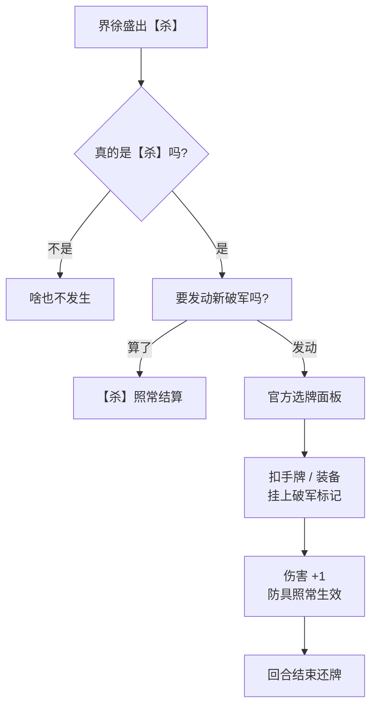

<p align="center">
  
</p>

<p align="center">
  
  
  
  
</p>

> 单机版没有界徐盛，那就自己补一个。🙃
>
> 一开始只想改改 XML 让他能选，结果发现技能根本跑不起来，于是一路逆向 + 打补丁，
> 前前后后折腾了几十个版本，到 v49a 终于让【新破军】在单机里完整跑通了。

## 🎉 现在能干嘛

- ✅ 单机里能直接选界徐盛（顺带还有曹冲）
- ✅ 出【杀】会问你要不要发动破军，取消的话【杀】照常结算
- ✅ 发动后弹出官方的选牌面板，扣对面的手牌或装备
- ✅ 扣掉的牌带破军标记，回合结束还回去
- ✅ 伤害 +1，而且白银狮子照样能挡
- ✅ 用【决斗】不会乱触发，一次【杀】也只问一次
- ✅ 普通对局不受影响，不会莫名其妙弃牌或乱回合

## 🧭 破军是怎么跑的



## 🪦 踩坑史

| 版本 | 干了啥 | 结果 |
|---|---|---|
| v42a / v43a | 一口气 hook 了一堆 native 逻辑 | 💥 整局乱套，莫名弃牌、回合错乱 |
| v44a | 全部回退，只留资源和配置 | 😐 稳了，但界徐盛选不了 |
| v45a | 改点将配置 | 🙂 能选了 |
| v46a | 把技能逻辑加回来 | 😵 一次【杀】问好几遍 |
| v47a | 加个防重复的 guard | 🙂 好了 |
| v48a | 破军 +1 挪到伤害计算前面 | 🙂 白银狮子终于正常 |
| **v49a** | **检查触发源到底是不是【杀】** | 🎉 **【决斗】不再误触发，收工** |

<details>
<summary>🔬 v49a 那个关键补丁（给好奇的人看）</summary>

```text
parentAction = *(optAction + 0xa0)
parentVptr   = *(parentAction)
require parentVptr == Sha vtable 0x1010ea9a0
```

就是看一眼触发破军的那个动作的虚表，是【杀】才放行。完整反汇编在
[`reports/sgs_v48_sha_only_trigger_fix_v49a_report.txt`](reports/sgs_v48_sha_only_trigger_fix_v49a_report.txt)。

</details>

## 🤷 已知小毛病

- 扣对面装备会触发白银狮子、孙尚香【枭姬】这类“失去装备”的技能。按规则这其实说得通，就没管。
- 被扣掉的装备有时还会出现在过拆 / 顺手的面板里，但点了没用，应该只是显示缓存，懒得冒险改。

## 📦 里面有啥

```text
├── reports/     # 从 v44a 到 v49a 的维护报告和构建记录
├── skills/      # 逆向 / 打补丁时攒下来的经验笔记
└── artifacts/   # v49a 安装包（未签名）和 sha256
```

<details>
<summary>🧪 想自己装来玩？</summary>

1. 先校验一下 IPA：

   ```text
   8711fbe9730e7c05031057365e3e91fe4fce2ef96fbc95dcde1136efe8f1efb8  sgs_v48_sha_only_trigger_fix_v49a.ipa
   ```

   macOS / Linux 用 `shasum -a 256`，Windows 用 `Get-FileHash -Algorithm SHA256`。

2. 用你自己的证书或工具重签（AltStore、Sideloadly、TrollStore 都行）。这里不提供证书。

3. 进游戏试试：普通武将先打一局 → 选界徐盛出【杀】→ 取消 / 发动各试一次 → 扣手牌、扣装备 → 打一下带白银狮子的 → 用【决斗】确认不触发。

</details>

<details>
<summary>📝 给以后的自己：别再踩的坑</summary>

1. 以 v49a 为准，出问题就退回这里。
2. 别再搞 v42a / v43a 那种全量 native hook。
3. 一次只改一处，改完先打一局普通局。
4. 先保证游戏能正常玩，再抠技能细节。
5. UI 显示问题别动结算逻辑。
6. 改 action / state 之前，先搞清楚 parent action、source / target role 到底是什么。

</details>

---

<sub>纯个人娱乐和学习逆向用，不商用。《三国杀》的版权归原权利人。</sub>

<p align="center">
  
</p>
