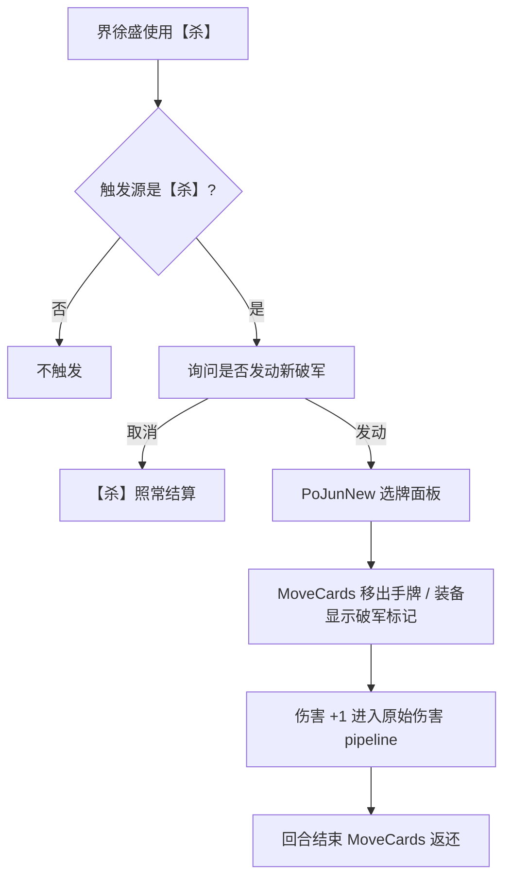

<p align="center">
  
</p>

<p align="center">
  
  
  
  
</p>

个人业余项目。单机版客户端里没有界徐盛，我想让他在离线对局中完整可用，而不只是能在选将界面出现。

## 实现思路

单机客户端里没有【新破军】的现成实现，但它需要的各个环节，游戏里其他武将、卡牌已经有了。所以我没有从零写技能逻辑，而是找到这些现有模块，把它们拼接成一条完整的技能流程：

| 技能环节 | 复用的现有模块 |
|---|---|
| 出【杀】时询问是否发动 | 原生技能提示 action，加上触发源校验 |
| 选择目标的手牌 / 装备 | 官方 `PoJunNew` 选牌面板 |
| 将牌移出并标记 | 原生 `MoveCards`，从手牌 / 装备区移到移出区 |
| 伤害 +1 | 原始伤害 helper pipeline（防具、减伤、封顶照常生效） |
| 回合结束返还 | 回合结束事件 + `MoveCards` 回原区域 |

这样做的好处是，各个环节的行为和原版一致，和其他武将、装备的交互也沿用原来的事件链。



## 当前效果（v49a）

- 单机中可以正常选择界徐盛（曹冲也一并可选）
- 只有【杀】会触发新破军，【决斗】不会误触发；一次【杀】只询问一次
- 取消发动时，原【杀】正常结算
- 可以扣置目标的手牌或装备，带破军标记，当前回合结束后返还
- 伤害 +1，白银狮子等减伤、封顶效果正常
- 普通对局的出牌、伤害、弃牌、回合流程不受影响

## 版本记录

| 版本 | 改动 | 结果 |
|---|---|---|
| v42a / v43a | 大范围 hook native 逻辑 | 整局结算出错（异常弃牌、回合错乱） |
| v44a | 回退全部 hook，只保留资源和配置 | 稳定，但武将不可选 |
| v45a | 调整点将配置 | 稳定，可选 |
| v46a | 接回技能逻辑 | 技能可用，但一次【杀】会重复询问 |
| v47a | 加入防重复检查 | 重复询问修复 |
| v48a | 伤害 +1 前移到伤害 pipeline 之前 | 白银狮子问题修复 |
| **v49a** | **校验触发源必须是【杀】** | **【决斗】不再误触发，当前稳定版本** |

<details>
<summary>v49a 的关键补丁</summary>

```text
parentAction = *(optAction + 0xa0)
parentVptr   = *(parentAction)
require parentVptr == Sha vtable 0x1010ea9a0
```

检查触发新破军的父动作的虚表，确认是【杀】才继续。完整反汇编见
[`reports/sgs_v48_sha_only_trigger_fix_v49a_report.txt`](reports/sgs_v48_sha_only_trigger_fix_v49a_report.txt)。

</details>

## 已知问题

- 扣置装备属于从装备区失去牌，会触发白银狮子、孙尚香【枭姬】等相关技能。这符合原事件链，所以没有屏蔽。
- 已扣置的装备有时仍会出现在过河拆桥 / 顺手牵羊的面板中，但无法选中，判断是显示缓存问题，暂时没有处理，以免影响结算逻辑。

## 仓库内容

```text
├── reports/     # v44a 到 v49a 的维护报告和构建记录
├── skills/      # 逆向和打补丁过程中的经验记录
└── artifacts/   # v49a 安装包（未签名）和 sha256
```

<details>
<summary>安装与测试</summary>

1. 校验 IPA：

   ```text
   8711fbe9730e7c05031057365e3e91fe4fce2ef96fbc95dcde1136efe8f1efb8  sgs_v48_sha_only_trigger_fix_v49a.ipa
   ```

   macOS / Linux 用 `shasum -a 256`，Windows 用 `Get-FileHash -Algorithm SHA256`。

2. 用自己的证书或工具重签后安装（AltStore、Sideloadly、TrollStore 等）。仓库不提供证书。

3. 测试顺序：普通武将先打一局 → 选界徐盛使用【杀】→ 分别测试取消和发动 → 扣置手牌、装备 → 对白银狮子测试伤害 → 使用【决斗】确认不触发。

</details>

<details>
<summary>维护原则</summary>

1. 以 v49a 为稳定基线。
2. 不再使用 v42a / v43a 那种大范围 native hook。
3. 每次只改一处，改完先跑普通对局回归。
4. 优先保证游戏主体结算正确，再处理技能细节。
5. UI 显示问题不通过修改结算逻辑解决。
6. 修改 action / state 逻辑前，先确认 parent action、source / target role 的实际语义。

</details>

---

<sub>个人学习与逆向研究用途，非商业。《三国杀》相关版权归原权利人所有。</sub>

<p align="center">
  
</p>
